# ⚡ i1 — AI-Powered Website Builder

<p align="center">
  <strong>Describe it. Generate it. Build it. Ship it.</strong>
</p>

<p align="center">
  An intelligent, full-stack AI website builder and prototyping platform that transforms natural language prompts into complete, interactive React applications.
</p>

<p align="center">
  
  
  
  
  
  
</p>

<p align="center">
  <a href="#-overview">Overview</a> •
  <a href="#-features">Features</a> •
  <a href="#-system-design">System Design</a> •
  <a href="#-architecture">Architecture</a> •
  <a href="#-tech-stack">Tech Stack</a> •
  <a href="#-getting-started">Getting Started</a> •
  <a href="#-api-reference">API Reference</a>
</p>

---

## 📌 Table of Contents

- [Overview](#-overview)
- [Features](#-features)
- [Application Workflow](#-application-workflow)
- [System Design](#-system-design)
  - [High-Level Architecture](#1-high-level-architecture)
  - [Core Components](#2-core-components)
  - [Project Generation Pipeline](#3-project-generation-pipeline)
  - [Sequence Diagrams](#4-sequence-diagrams)
  - [Database Design](#5-database-design)
  - [AI Engine Architecture](#6-ai-engine-architecture)
  - [Revision and Diff Engine](#7-revision-and-diff-engine)
  - [Preview and Execution Architecture](#8-preview-and-execution-architecture)
  - [Export Architecture](#9-export-architecture)
  - [Error Handling and Recovery](#10-error-handling-and-recovery)
  - [Security Architecture](#11-security-architecture)
  - [Scalability Considerations](#12-scalability-considerations)
- [Tech Stack](#-tech-stack)
- [Project Structure](#-project-structure)
- [Getting Started](#-getting-started)
- [Environment Variables](#-environment-variables)
- [API Reference](#-api-reference)
- [AI Engine and Prompt Engineering](#-ai-engine-and-prompt-engineering)
- [Export and Preview](#-export-and-preview)
- [Development Roadmap](#-development-roadmap)
- [Contributing](#-contributing)
- [License](#-license)

---

# 🚀 Overview

**i1** is an AI-powered, full-stack website generation and prototyping platform built using the MERN stack and modern AI technologies.

It allows users to create complete React applications using natural language instead of manually writing every component, stylesheet, and configuration file.

For example:

> Create a modern portfolio website for a software developer with a dark theme, animated hero section, project showcase, responsive navigation, and contact form.

i1 converts this prompt into a structured application through an autonomous multi-stage generation pipeline.

### What happens behind the scenes?

1. **Understand:** The AI interprets the user's requirements.
2. **Plan:** It generates a modular project architecture and file manifest.
3. **Generate:** Individual files are generated concurrently with controlled concurrency.
4. **Validate:** Generated content is normalized and checked for common code issues.
5. **Persist:** Generated files and progress are stored in MongoDB.
6. **Preview:** The application is rendered inside an interactive Sandpack environment.
7. **Iterate:** Users can request changes through conversational AI or edit files manually.
8. **Export:** The completed project can be downloaded as a standalone Vite application.

The goal of i1 is to make application development more accessible through an AI-assisted development workflow.

## 🎯 Product Philosophy

| Principle | Description |
|---|---|
| Prompt-driven development | Turn natural language into working applications. |
| Modular generation | Generate structured multi-file projects instead of isolated code snippets. |
| Iterative development | Improve applications through conversational instructions. |
| Immediate feedback | Preview changes without leaving the builder. |
| Developer control | Allow manual editing alongside AI-generated code. |
| Portability | Export generated projects as independent source repositories. |

---

# ✨ Features

## 🤖 AI-Powered Development

- Natural language to React application generation.
- Two-stage planning and code generation.
- Multi-file project architecture.
- Concurrent file generation using `p-map`.
- OpenRouter-powered model integration.
- Structured AI outputs validated using Zod.
- Automatic Markdown code-block normalization.
- Common missing-import and dependency corrections.

## ⚡ Interactive Development Environment

- Live React preview using Sandpack.
- Integrated code editor.
- File explorer and file navigation.
- Conversational AI modification.
- Generation progress dashboard.
- Debounced automatic saving.
- Full-page application preview.

## 🧠 Intelligent Code Revision

- Context-aware code modifications.
- File-level `create`, `update`, and `delete` operations.
- Targeted search-and-replace updates.
- Existing project context supplied to the AI.
- Avoids unnecessary full-project regeneration.

## 🔐 User and Project Management

- User registration and authentication.
- JWT-based authentication.
- HTTP-only session cookies.
- bcrypt password hashing.
- User-specific project management.
- Public application publishing.

## 📦 Export and Sharing

- One-click ZIP export.
- Standalone Vite project structure.
- Automatic dependency detection.
- Preconfigured application entry points.
- Public project URLs.

---

# 🔄 Application Workflow

The following diagram represents the complete user journey.

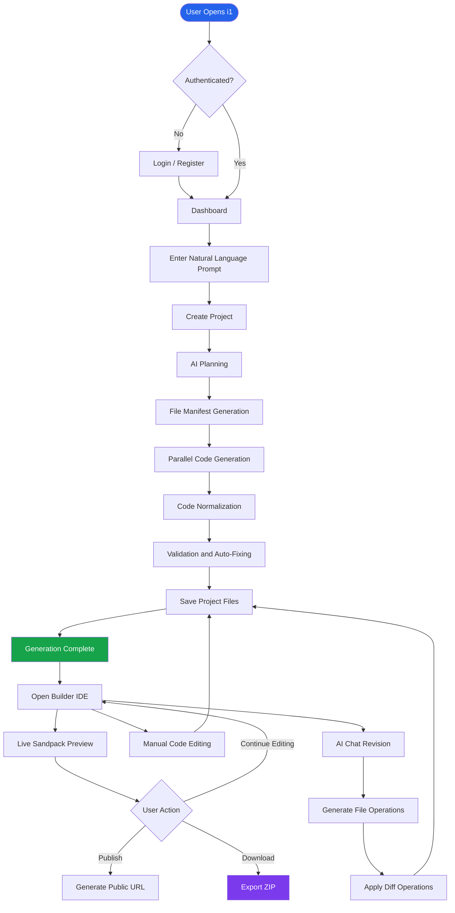

---

# 🏗️ System Design

This section explains the architectural decisions, component responsibilities, communication patterns, and internal workflows behind i1.

## 1. High-Level Architecture

i1 follows a client-server architecture with an asynchronous AI generation workflow.

The application consists of three primary layers:

1. **Presentation Layer:** React frontend responsible for user interaction, project editing, and live preview.
2. **Application Layer:** Express backend responsible for authentication, project management, AI orchestration, and file operations.
3. **Data and AI Layer:** MongoDB for persistent storage and OpenRouter for LLM inference.

### High-Level Architecture Diagram

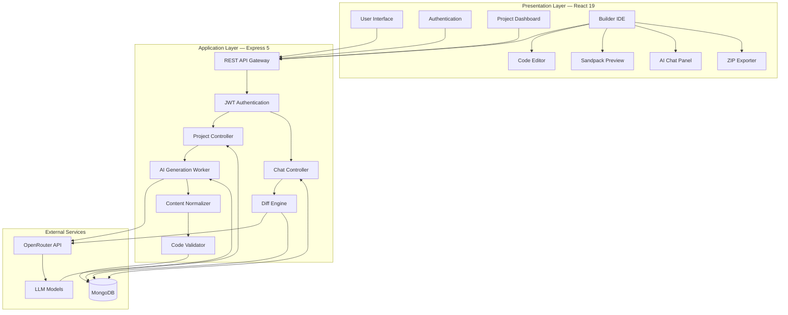

### Architecture Responsibilities

| Component | Responsibility |
|---|---|
| React Client | UI rendering and user interactions |
| AppContext | Shared authentication and project state |
| Express API | HTTP request handling and routing |
| Authentication Middleware | JWT verification and access control |
| Project Controller | Project CRUD and generation orchestration |
| AI Worker | AI planning and file generation |
| AI Service | OpenRouter communication and model orchestration |
| Content Normalizer | Cleaning and standardizing generated content |
| Code Validator | Common code and import corrections |
| Diff Engine | Applying structured file modifications |
| MongoDB | Persistent users, projects, files, and messages |
| Sandpack | Browser-based React execution and preview |

---

## 2. Core Components

### 2.1 Frontend Architecture

The frontend is built using React 19 and Vite.

It follows a component-based architecture with centralized application state through React Context.

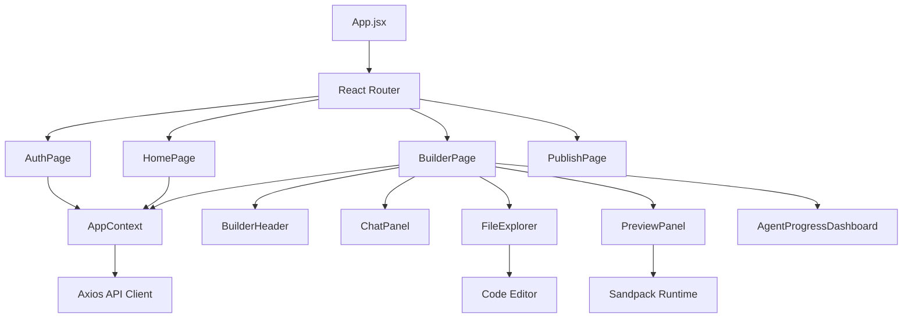

**Key responsibilities:**

- `AppContext.jsx`: Global user and project state.
- `BuilderPage.jsx`: Main development workspace.
- `ChatPanel.jsx`: Conversational AI interface.
- `FileExplorer.jsx`: Project directory and file navigation.
- `PreviewPanel.jsx`: Embedded live application preview.
- `AgentProgressDashboard.jsx`: Generation progress visualization.
- `exportProject.js`: ZIP generation and download.
- `sandpackUtils.js`: Preview configuration and dependency detection.

### 2.2 Backend Architecture

The backend follows a modular Express architecture.

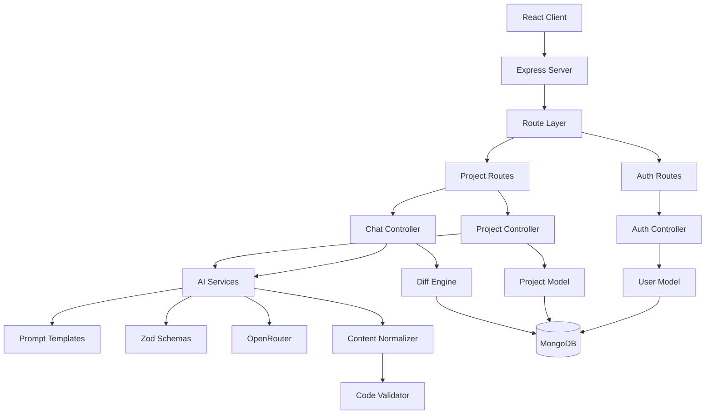

**Design principles:**

- Separation of concerns.
- Reusable service modules.
- Controller-based request handling.
- Centralized authentication middleware.
- Schema-based AI output validation.
- Independent AI generation and revision workflows.

---

## 3. Project Generation Pipeline

The most important subsystem in i1 is its AI-powered project generation engine.

Instead of asking an LLM to generate an entire application in one response, i1 divides the process into smaller, structured tasks.

### Generation Stages

<details>
<summary><strong>Stage 1 — Prompt Understanding</strong></summary>

The user submits a natural language description.

Example:

```text
Create a responsive SaaS landing page with:
- Dark theme
- Pricing section
- Feature cards
- Animated hero section
- Responsive navigation
```

The backend receives the request and initializes a new project.

</details>

<details>
<summary><strong>Stage 2 — Architecture Planning</strong></summary>

The AI planner converts the prompt into a structured file manifest.

Example:

```json
{
  "files": [
    {
      "path": "/App.jsx",
      "description": "Main application component"
    },
    {
      "path": "/components/Navbar.jsx",
      "description": "Responsive navigation"
    },
    {
      "path": "/components/Hero.jsx",
      "description": "Hero section"
    },
    {
      "path": "/components/Pricing.jsx",
      "description": "Pricing cards"
    },
    {
      "path": "/styles.css",
      "description": "Global application styling"
    }
  ]
}
```

The manifest establishes the intended application structure before code generation starts.

</details>

<details>
<summary><strong>Stage 3 — Parallel File Generation</strong></summary>

The generation engine processes the planned files using `p-map`.

Instead of sequentially generating every file, it uses controlled concurrency.

```javascript
import pMap from "p-map";

const generatedFiles = await pMap(
  fileManifest,
  async (file) => {
    const content = await generateFile({
      prompt: userPrompt,
      file,
      existingFiles: generatedFilesContext
    });

    return {
      path: file.path,
      content
    };
  },
  {
    concurrency: 6
  }
);
```

*Illustrative pseudocode: actual context handling and generation dependencies are implemented by the AI service.*

Benefits:

- Reduced generation time.
- Controlled API concurrency.
- Modular output.
- Better separation of generated files.

</details>

<details>
<summary><strong>Stage 4 — Normalization and Validation</strong></summary>

AI-generated content is not always directly usable.

The normalization and validation stages address common problems:

- Markdown code fences.
- Unexpected formatting.
- Missing imports.
- Common React and Lucide import issues.
- Inconsistent generated content.
- Missing or incomplete files.

</details>

<details>
<summary><strong>Stage 5 — Persistence and Progress Tracking</strong></summary>

Generated files and generation progress are stored in MongoDB.

The frontend periodically retrieves the latest project state to update the generation dashboard.

</details>

<details>
<summary><strong>Stage 6 — Live Preview</strong></summary>

The completed file collection is supplied to Sandpack.

The user can interact with the generated application without downloading or manually configuring a local development environment.

</details>

### Generation Pipeline Diagram

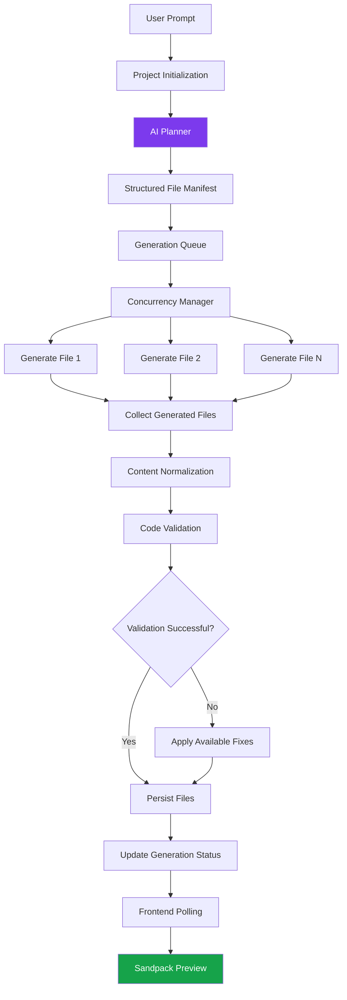

### Concurrency Model

i1 uses bounded concurrency rather than launching unlimited simultaneous LLM requests.

| Parameter | Configuration |
|---|---|
| Generation strategy | Parallel |
| Concurrency manager | `p-map` |
| Default concurrency | 6 |
| Generation unit | Individual project file |
| AI provider | OpenRouter |
| Output validation | Zod and custom validation |
| Persistence | MongoDB |

---

## 4. Sequence Diagrams

### 4.1 Initial Project Generation

This diagram explains the communication between the client, server, AI service, and database.

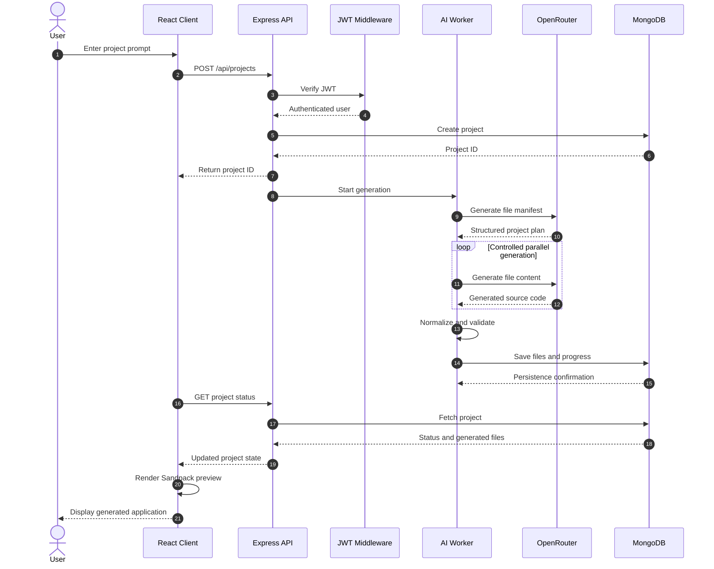

### 4.2 Conversational AI Revision

Instead of regenerating the entire application, the revision engine works with targeted file operations.

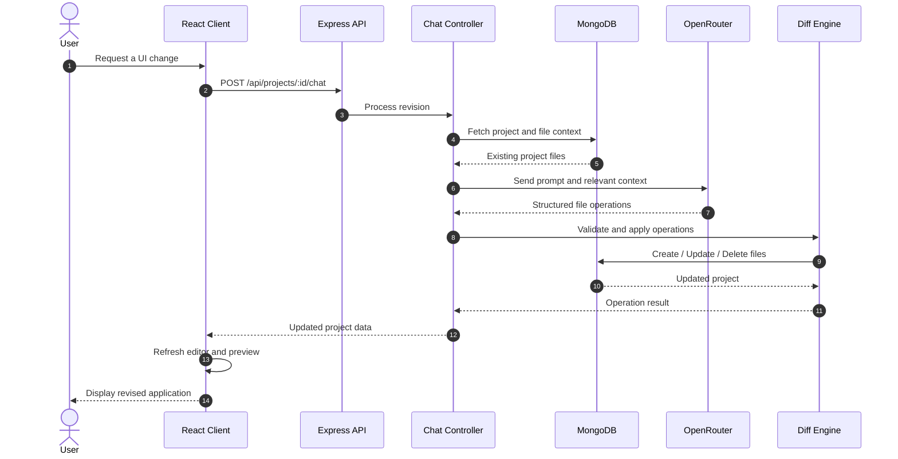

### 4.3 Authentication Flow

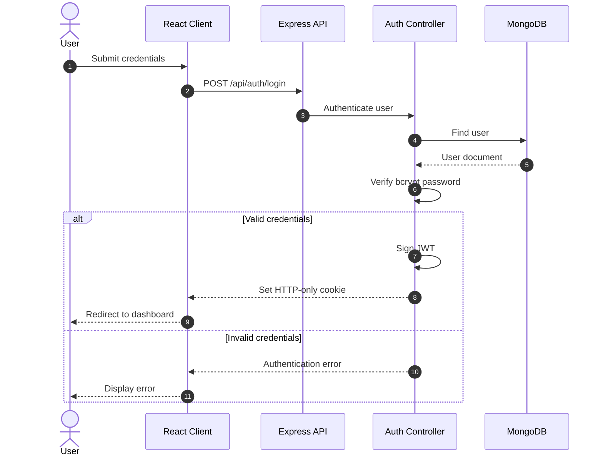

---

## 5. Database Design

i1 uses MongoDB with Mongoose for persistent application data.

The primary data entities are:

- User
- Project
- Project files
- Chat messages

### Entity Relationship Diagram

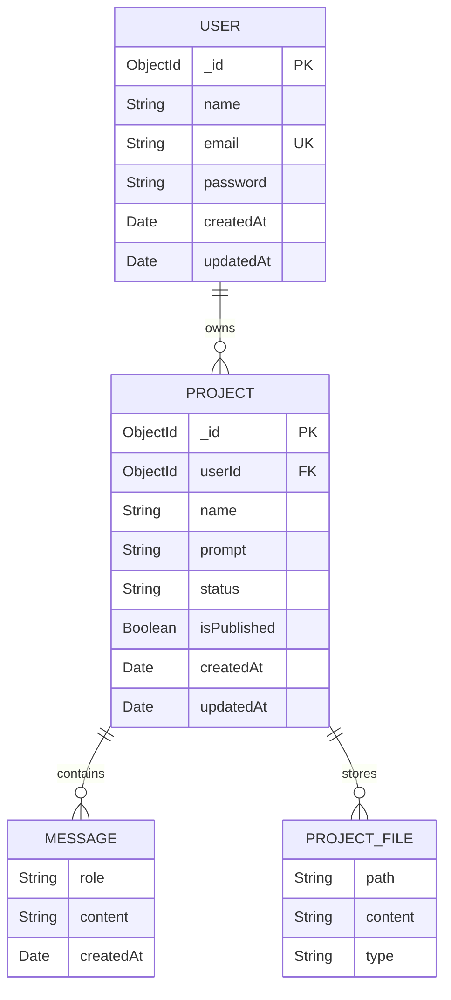

*Logical relationship diagram. The actual project file and message representation follows the embedded fields and schemas defined in the Mongoose models.*

### User Model

The User model stores account and authentication information.

Typical fields:

| Field | Type | Purpose |
|---|---|---|
| `_id` | ObjectId | Unique user identifier |
| `name` | String | User name |
| `email` | String | Unique account email |
| `password` | String | bcrypt password hash |
| `createdAt` | Date | Account creation time |
| `updatedAt` | Date | Last update |

### Project Model

The Project model stores application information, generated files, and conversational history.

Typical logical structure:

```json
{
  "_id": "project_id",
  "userId": "user_id",
  "name": "SaaS Landing Page",
  "prompt": "Create a modern SaaS landing page",
  "status": "completed",
  "isPublished": false,
  "files": [
    {
      "path": "/App.jsx",
      "content": "export default function App() {}"
    },
    {
      "path": "/styles.css",
      "content": "body { margin: 0; }"
    }
  ],
  "messages": [
    {
      "role": "user",
      "content": "Create a landing page"
    },
    {
      "role": "assistant",
      "content": "Your project has been generated."
    }
  ]
}
```

*Illustrative document representation; field names and nesting should be checked against the actual Mongoose schemas.*

### Database Design Considerations

- Every project belongs to an authenticated user.
- Project access must be scoped to its owner.
- Public publishing should expose only intentionally shared project data.
- Frequently queried fields should have appropriate indexes.
- Large file collections and long chat histories may eventually require separate collections or document partitioning.

---

## 6. AI Engine Architecture

The AI engine is responsible for transforming natural language into structured application code.

### Technology

| Technology | Responsibility |
|---|---|
| OpenRouter | LLM API gateway |
| Vercel AI SDK | AI model integration |
| Zod v4 | Structured response validation |
| `p-map` | Controlled concurrent generation |
| Custom Prompts | Planning and code generation instructions |

### Two-Stage Generation

**Stage A — Architecture Planning**

Input:

```text
Build a modern developer portfolio.
```

Output:

```text
Project Manifest
├── App.jsx
├── styles.css
├── components/
│   ├── Navbar.jsx
│   ├── Hero.jsx
│   ├── About.jsx
│   ├── Projects.jsx
│   └── Contact.jsx
└── assets/
```

**Stage B — File Generation**

Each planned file is generated using its description, original requirements, and relevant existing project context.

This makes the generation process more modular than single-response code generation.

### AI Response Validation

The AI response is processed through a structured pipeline:

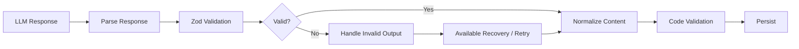

---

## 7. Revision and Diff Engine

A major design decision in i1 is using structured file operations for subsequent AI modifications.

Regenerating an entire project for every small change can increase latency, token consumption, and the possibility of breaking existing functionality.

The diff engine instead applies targeted operations.

### Supported Operations

| Operation | Description |
|---|---|
| `create` | Add a new file |
| `update` | Modify an existing file |
| `delete` | Remove a file |

### Example

User instruction:

```text
Add a testimonials section below the pricing section.
```

The AI can return an operation such as:

```json
{
  "operations": [
    {
      "type": "create",
      "path": "/components/Testimonials.jsx",
      "content": "export default function Testimonials() {}"
    },
    {
      "type": "update",
      "path": "/App.jsx",
      "search": "// Pricing Section",
      "replace": "<Pricing />\n<Testimonials />"
    }
  ]
}
```

*Illustrative operation format; the exact response schema is defined by the implemented diff service.*

### Diff Application Workflow

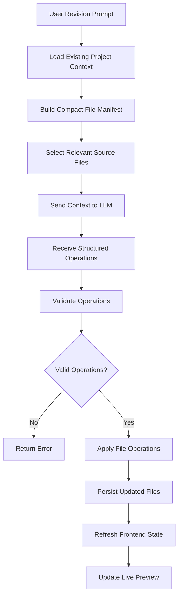

### Benefits

- Avoids unnecessary full-project regeneration.
- Reduces AI context requirements.
- Preserves unrelated source files.
- Enables targeted modifications.
- Supports iterative development.

---

## 8. Preview and Execution Architecture

i1 integrates `@codesandbox/sandpack-react` to provide an interactive preview environment.

The generated source files are passed into Sandpack, which handles compilation and browser execution.

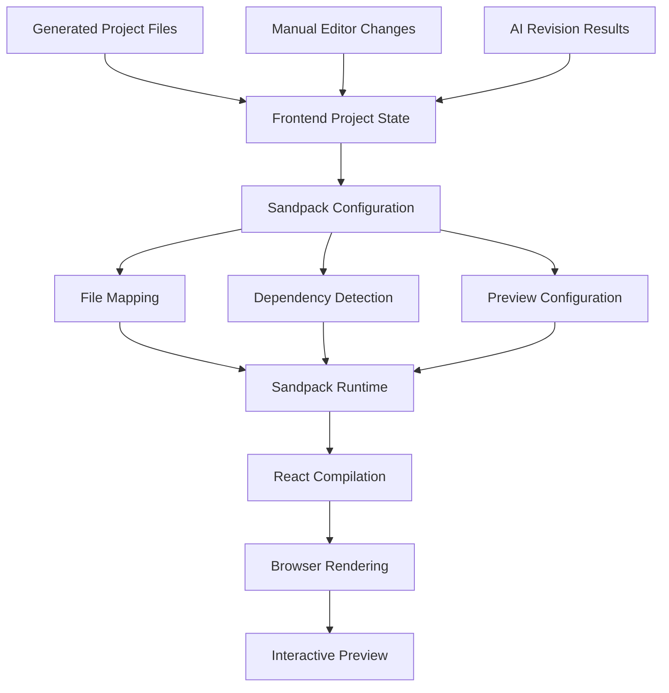

### Preview Capabilities

- Live React application rendering.
- Automatic preview refresh when file state changes.
- Sandpack error monitoring.
- Dependency configuration.
- Full-page preview mode.
- Interactive application testing.

**Important:** Sandpack provides a browser-based preview environment. It should not be treated as a security boundary for executing arbitrary untrusted code on a production server.

---

## 9. Export Architecture

The export system packages the generated project into a standalone ZIP archive.

The frontend uses:

- `jszip`
- `file-saver`
- Custom export utilities

### Export Workflow

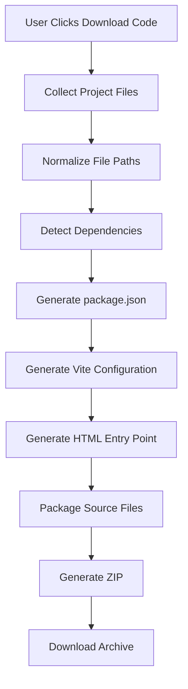

### Exported Project Structure

```text
generated-project/
│
├── index.html
├── package.json
├── vite.config.js
│
└── src/
    ├── main.jsx
    ├── App.jsx
    ├── styles.css
    │
    └── components/
        ├── Navbar.jsx
        ├── Hero.jsx
        └── Footer.jsx
```

### Running an Exported Project

```bash
# Extract the archive
unzip generated-project.zip

# Enter project directory
cd generated-project

# Install dependencies
npm install

# Start development server
npm run dev
```

---

## 10. Error Handling and Recovery

AI-generated code and external model APIs introduce failure scenarios that must be considered.

The application includes normalization and validation mechanisms to handle common generation issues.

### Failure Scenarios

| Failure | Expected Handling |
|---|---|
| Invalid AI response | Structured output validation |
| Markdown code fences | Content normalization |
| Missing common imports | Import correction where supported |
| Incomplete generation | Generation status and available recovery handling |
| Model API failure | Surface a meaningful error |
| Database failure | Handle persistence errors |
| Invalid file operation | Reject invalid diff operations |
| Sandpack compilation error | Display preview error |
| Network interruption | Show request failure and preserve recoverable state |

### Suggested Production Improvements

The following are recommended extensions rather than claims about currently implemented functionality:

- Exponential backoff for transient model failures.
- Generation retry limits.
- Per-file generation checkpoints.
- Idempotent generation jobs.
- Request cancellation.
- Dead-letter handling for failed background jobs.
- Generation timeouts.
- Structured error logging.
- AI token and cost tracking.

---

## 11. Security Architecture

Security is important because i1 handles user accounts, application source code, and externally generated content.

### Implemented Security Mechanisms

| Mechanism | Implementation |
|---|---|
| Authentication | JWT |
| Session transport | HTTP-only cookies |
| Password protection | bcrypt |
| API access control | Authentication middleware |
| Configuration secrets | Environment variables |
| Input/output structure | Zod schemas |

### Additional Production Security Considerations

**Authentication and authorization**
- Verify project ownership on every private project operation.
- Use secure cookie settings in production.
- Implement appropriate CSRF protection.
- Apply login rate limiting.

**API protection**
- Validate and sanitize user-controlled input.
- Apply request body size limits.
- Configure restrictive CORS origins.
- Avoid exposing internal server errors.

**AI and code generation**
- Never expose OpenRouter API keys to the frontend.
- Treat generated code as untrusted.
- Validate file paths and reject directory traversal.
- Avoid executing generated source code directly on the backend.
- Apply limits to prompt size, file count, and generation output.

**Publishing**
- Expose only intentionally published projects.
- Keep private project information and credentials out of public responses.

---

## 12. Scalability Considerations

The current architecture is suitable for an initial full-stack application. As usage grows, the AI generation workflow can be separated into independent services.

### Current Architecture

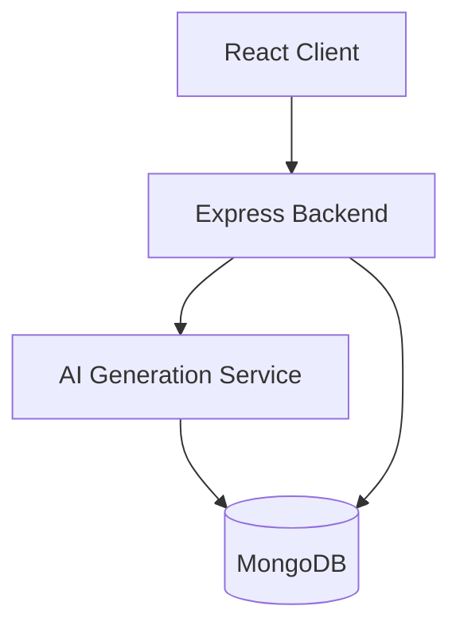

### Potential Scaled Architecture

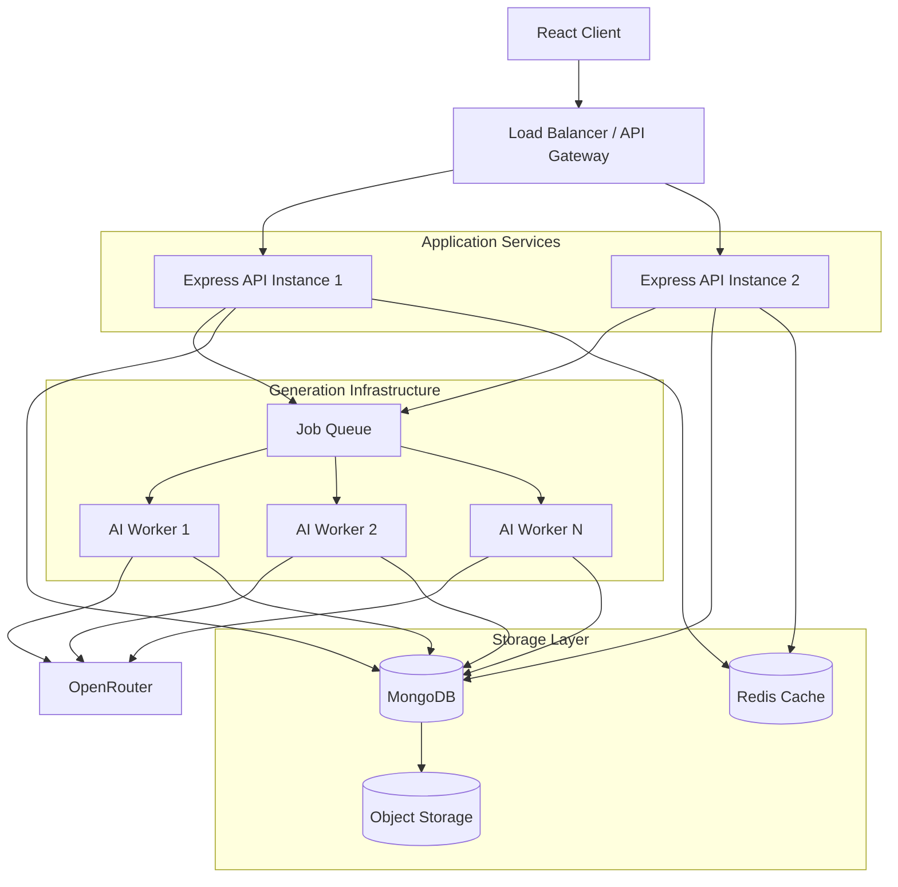

### Future Scalability Improvements

| Area | Potential Improvement | Benefit |
|---|---|---|
| API | Horizontal Express scaling | More concurrent users |
| Generation | Dedicated worker processes | Isolated AI workloads |
| Queue | BullMQ + Redis | Reliable job scheduling |
| Storage | Object storage | Better handling of large projects |
| Caching | Redis | Reduced repeated database reads |
| Progress | Server-Sent Events | Real-time generation updates |
| Observability | Structured logs and metrics | Easier debugging |
| AI | Model routing and fallback | Better reliability |
| Database | Indexing and data partitioning | Improved query performance |

These are architectural extension points, not dependencies required by the current implementation.

---

# 🛠️ Tech Stack

## Frontend

| Technology | Purpose |
|---|---|
| React 19 | UI framework |
| Vite 8 | Development server and bundler |
| React Router DOM v7 | Client-side routing |
| Tailwind CSS v4 | Styling |
| Lucide React | Icon library |
| Sandpack React | Live code preview |
| Axios | HTTP communication |
| React Hot Toast | Notifications |
| JSZip | ZIP generation |
| File Saver | File downloads |
| Lodash Debounce | Debounced saving |

## Backend

| Technology | Purpose |
|---|---|
| Node.js | JavaScript runtime |
| Express 5 | REST API framework |
| MongoDB | Database |
| Mongoose v9 | ODM |
| JSON Web Token | Authentication |
| bcrypt | Password hashing |
| Cookie Parser | Cookie management |
| Vercel AI SDK v7 | AI integration |
| OpenAI SDK Provider | OpenRouter-compatible model access |
| OpenRouter | LLM gateway |
| Zod v4 | Schema validation |
| p-map | Concurrency management |
| dotenv | Environment configuration |
| CORS | Cross-origin configuration |

---

# 📂 Project Structure

```text
i1/
│
├── README.md
│
├── client/                          # React frontend
│   │
│   ├── public/
│   │
│   ├── src/
│   │   │
│   │   ├── api/
│   │   │   └── api.js               # Axios configuration
│   │   │
│   │   ├── assets/                  # Static assets
│   │   │
│   │   ├── components/
│   │   │   ├── AgentProgressDashboard.jsx
│   │   │   ├── BuilderHeader.jsx
│   │   │   ├── ChatPanel.jsx
│   │   │   ├── FileExplorer.jsx
│   │   │   ├── FullPagePreview.jsx
│   │   │   ├── Loading.jsx
│   │   │   ├── LoginLeft.jsx
│   │   │   ├── PreviewPanel.jsx
│   │   │   ├── PromptInput.jsx
│   │   │   ├── PublishModel.jsx
│   │   │   └── SandpackErrorMonitor.jsx
│   │   │
│   │   ├── context/
│   │   │   └── AppContext.jsx
│   │   │
│   │   ├── pages/
│   │   │   ├── AuthPage.jsx
│   │   │   ├── BuilderPage.jsx
│   │   │   ├── HomePage.jsx
│   │   │   ├── Layout.jsx
│   │   │   ├── PreviewPage.jsx
│   │   │   └── PublishPage.jsx
│   │   │
│   │   ├── utils/
│   │   │   ├── exportProject.js
│   │   │   └── sandpackUtils.js
│   │   │
│   │   ├── App.jsx
│   │   ├── main.jsx
│   │   └── index.css
│   │
│   ├── .env
│   ├── package.json
│   └── vite.config.js
│
└── server/                           # Express backend
    │
    ├── config/
    │   └── db.js                    # MongoDB connection
    │
    ├── controllers/
    │   ├── authController.js
    │   ├── chatController.js
    │   └── projectController.js
    │
    ├── middleware/
    │   └── authMiddleware.js
    │
    ├── models/
    │   ├── Project.js
    │   └── User.js
    │
    ├── routes/
    │   ├── authRoutes.js
    │   └── projectRoutes.js
    │
    ├── services/
    │   ├── ai.js
    │   ├── aiSchemas.js
    │   ├── codeValidator.js
    │   ├── contentNormalizer.js
    │   ├── diff.js
    │   └── prompts.js
    │
    ├── .env
    ├── package.json
    └── server.js
```

---

# 🚦 Getting Started

Follow these instructions to run i1 locally.

## Prerequisites

Make sure you have the following installed:

| Requirement | Version / Requirement |
|---|---|
| Node.js | 18+ as configured by the project |
| npm | 9+ |
| MongoDB | Local instance or MongoDB Atlas |
| Git | Latest stable version |
| OpenRouter | Active API key |

Useful resources:

- [Node.js](https://nodejs.org/)
- [MongoDB Atlas](https://www.mongodb.com/cloud/atlas)
- [OpenRouter](https://openrouter.ai/)
- [Git](https://git-scm.com/)

## 1. Clone the Repository

```bash
git clone <YOUR_REPOSITORY_URL>
cd i1
```

## 2. Configure the Backend

Create `server/.env`.

```env
PORT=3000

# Database
MONGODB_URI=mongodb+srv://<user>:<password>@cluster0.mongodb.net/i1_db

# Authentication
JWT_SECRET=your_super_secret_jwt_key

# CORS
ORIGINS=http://localhost:5173,http://localhost:3000

# AI Configuration
OPENROUTER_API_KEY=sk-or-v1-your-openrouter-api-key
OPENROUTER_MODEL=cohere/north-mini-code:free

# AI Concurrency
AI_MAX_CONCURRENCY=6
```

## 3. Configure the Frontend

Create `client/.env`.

```env
VITE_BASE_URL=http://localhost:3000
```

## 4. Install Dependencies

Install backend dependencies:

```bash
cd server
npm install
```

Install frontend dependencies:

```bash
cd ../client
npm install
```

## 5. Start the Backend

From the `server` directory:

```bash
npm run dev
```

The backend will run at:

```text
http://localhost:3000
```

## 6. Start the Frontend

Open another terminal:

```bash
cd client
npm run dev
```

The frontend will run at:

```text
http://localhost:5173
```

## 7. Open i1

Navigate to:

**http://localhost:5173**

Register an account, create your first project, and start building with AI.

---

# ⚙️ Environment Variables

## Backend Configuration

| Variable | Description | Required |
|---|---|---|
| `PORT` | Backend server port | Yes |
| `MONGODB_URI` | MongoDB connection string | Yes |
| `JWT_SECRET` | JWT signing secret | Yes |
| `ORIGINS` | Allowed CORS origins | Yes |
| `OPENROUTER_API_KEY` | OpenRouter API key | Yes |
| `OPENROUTER_MODEL` | Selected LLM model | Yes |
| `AI_MAX_CONCURRENCY` | Maximum concurrent file generations | No |

## Frontend Configuration

| Variable | Description | Required |
|---|---|---|
| `VITE_BASE_URL` | Backend API base URL | Yes |

**Security note:** Never commit `.env` files or expose private API keys in frontend environment variables. Configure production secrets through your hosting provider.

---

# 📡 API Reference

All API endpoints use JSON request and response bodies unless otherwise specified.

## Authentication API

Base path: `/api/auth`

| Method | Endpoint | Description | Authentication |
|---|---|---|---|
| POST | `/register` | Register a new account | No |
| POST | `/login` | Authenticate and set JWT cookie | No |
| POST | `/logout` | Clear authentication cookie | No |
| GET | `/me` | Retrieve authenticated user | Yes |

## Project Management API

Base path: `/api/projects`

| Method | Endpoint | Description | Authentication |
|---|---|---|---|
| POST | `/` | Create a project from a prompt | Yes |
| GET | `/` | Retrieve user's projects | Yes |
| GET | `/:id` | Retrieve project details and files | Yes |
| PUT | `/:id/files` | Save project files | Yes |
| DELETE | `/:id` | Delete a project | Yes |
| POST | `/:id/chat` | Submit an AI revision prompt | Yes |
| POST | `/:id/publish` | Toggle public publishing | Yes |
| GET | `/public/:id` | Retrieve a published project | No |

### Example: Create a Project

**Request**

```http
POST /api/projects
Content-Type: application/json
```

```json
{
  "prompt": "Create a modern developer portfolio with a dark theme"
}
```

**Expected workflow**

1. Verify the authenticated user.
2. Initialize the project.
3. Trigger AI generation.
4. Return the project identifier.
5. Retrieve updated generation status and files through project requests.

### Example: Submit a Revision

**Request**

```http
POST /api/projects/:id/chat
Content-Type: application/json
```

```json
{
  "message": "Add an animated testimonials section"
}
```

The backend processes the revision and applies the resulting file operations.

*Exact response schemas should be documented against the current controller implementations.*

---

# 🧠 AI Engine and Prompt Engineering

The AI engine uses specialized prompt templates for different development tasks.

| Prompt Module | Responsibility |
|---|---|
| Planning Prompt | Generate the application file manifest |
| File Generation Prompt | Generate individual source files |
| Revision Prompt | Understand modification requirements |
| Context Prompt | Supply relevant existing project information |

### Design Goals

- Produce modular and readable code.
- Maintain consistency across generated components.
- Avoid unnecessary file regeneration.
- Follow structured response formats.
- Minimize invalid or incomplete outputs.
- Keep generation concurrency controlled.

### Model Configuration

i1 integrates with OpenRouter, allowing model selection through environment configuration.

```env
OPENROUTER_API_KEY=your_api_key
OPENROUTER_MODEL=your_preferred_model
```

The selected model should support the structured output and code generation capabilities required by the AI service.

---

# 💾 Export and Preview

## Live Preview

The preview system uses Sandpack to render generated React applications.

Main capabilities:

- Interactive React rendering.
- Live file updates.
- Dependency configuration.
- Error monitoring.
- Full-page preview.

## Download Source Code

The export functionality generates a standalone Vite project.

The downloaded project includes:

- React source files.
- Components and styles.
- Package configuration.
- Vite configuration.
- HTML entry point.
- Detected dependencies.

The resulting ZIP can be extracted and developed independently of i1.

---

# 🗺️ Development Roadmap

Potential improvements for future versions:

| Feature | Description | Priority |
|---|---|---|
| Streaming Generation | Stream file generation progress to the frontend | High |
| Real-time Updates | Replace polling with SSE or WebSockets | High |
| AI Self-Healing | Retry failed generation and repair compile errors | High |
| Undo / Redo | Version-aware file editing | High |
| GitHub Integration | Export projects directly to GitHub | Medium |
| Multi-Model Routing | Select models based on task complexity | Medium |
| Component Library | Reusable design systems and templates | Medium |
| Image Generation | Generate and integrate application assets | Medium |
| Collaborative Editing | Multiple users working on one project | Medium |
| Deployment Integration | Publish applications to hosting platforms | Medium |
| Usage Analytics | Token consumption and generation costs | Medium |

---

# 🤝 Contributing

Contributions, ideas, and suggestions are welcome.

### Contribution Workflow

1. Fork the repository.
2. Create a new feature branch.
3. Implement your changes.
4. Test the changes locally.
5. Commit your work.
6. Open a pull request.

```bash
# Fork and clone your repository

git clone <YOUR_FORK_URL>

# Create a feature branch
git checkout -b feature/your-feature

# Commit changes
git add .
git commit -m "feat: add your feature"

# Push branch
git push origin feature/your-feature
```

Please keep contributions modular, readable, and consistent with the existing architecture.

---

# 📄 License

This project is licensed under the **ISC License**.

See the [LICENSE](LICENSE) file for more information.

---

<p align="center">
  <strong>⚡ Built with React, Node.js, MongoDB, and AI.</strong>
</p>

<p align="center">
  Turning ideas into applications, one prompt at a time.
</p>