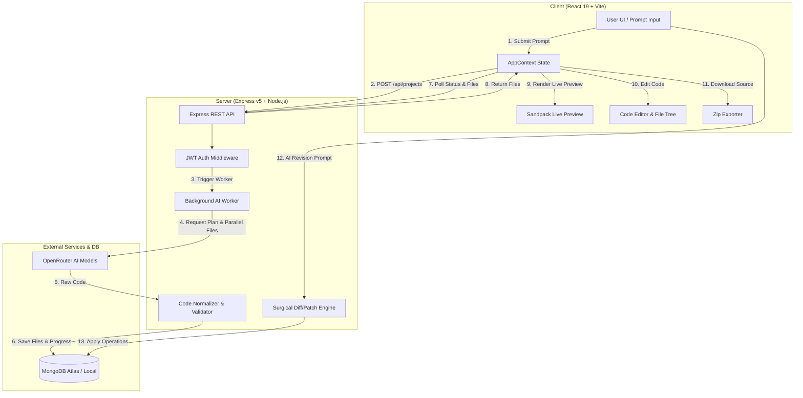

# ⚡ i1

> An intelligent, full-stack AI website builder and prototyping platform powered by React, Express, MongoDB, and LLMs (via OpenRouter & Vercel AI SDK).


---

## 📌 Table of Contents

- [Overview](#-overview)
- [Key Features](#-key-features)
- [System Architecture](#-system-architecture)
- [Tech Stack](#-tech-stack)
- [Project Structure](#-project-structure)
- [Getting Started](#-getting-started)
  - [Prerequisites](#prerequisites)
  - [Environment Configuration](#environment-configuration)
  - [Installation & Local Execution](#installation--local-execution)
- [API Reference](#-api-reference)
  - [Authentication API](#authentication-api)
  - [Project Management & Chat API](#project-management--chat-api)
- [AI Engine & Diff Mechanism](#-ai-engine--diff-mechanism)
- [Export & Preview Capabilities](#-export--preview-capabilities)
- [License](#-license)

---

## 🚀 Overview

**i1** is an end-to-end platform for generating, previewing, editing, and publishing React web applications directly from natural language prompts. 

Users simply describe the website or UI component they want to create (e.g., *"Create a sleek portfolio website for a software developer with dark mode and project showcase"*), and **i1** autonomously:
1. **Plans** the modular file architecture and component breakdown.
2. **Generates** full React code & custom CSS across multiple files concurrently.
3. **Validates & Heals** syntax errors, broken imports, or missing dependencies on the fly.
4. **Renders** a live, interactive web preview using embedded Sandpack.
5. **Revises** existing projects iteratively via conversational AI prompts using a diff/patch algorithm.
6. **Exports** clean, standalone Vite + Tailwind CSS zip archives ready for production deployment.

---

## ✨ Key Features

- **🤖 Autonomous AI Planning & Multi-File Code Generation**: Phase 1 AI plans the file tree (`/App.js`, `/styles.css`, component files); Phase 2 generates code in parallel with controlled concurrency (`p-map`).
- **📊 Real-Time Generation Dashboard**: Visual progress monitor tracking planned files, active file generation, and completion status.
- **⚡ Live In-Browser Execution**: Embedded `@codesandbox/sandpack-react` preview running React components with live hot-reloading.
- **💬 Conversational AI Code Revisions**: Send follow-up requests to modify existing code. The server calculates precise `create`, `update`, or `delete` patches using a custom diff engine.
- **🛠️ Built-in IDE & File Tree**: In-browser code editor allowing direct manual code tweaks with auto-saving (`lodash.debounce`).
- **🔐 Secure Authentication**: JWT cookie-based session management with bcrypt password hashing.
- **🌐 Public Publishing & Sharing**: Share generated applications with a unique public URL (`/publish/:id`).
- **📦 One-Click ZIP Export**: Package generated applications into a turnkey Vite + React + Tailwind CSS repository ready for `npm install && npm run dev`.
- **🩹 Automatic Code Normalization & Auto-Fixing**: Sanitizes AI-generated Markdown code blocks and fixes missing React/Lucide icon imports automatically.

---

## 🏗️ System Architecture



---

## 🛠️ Tech Stack

### Frontend (`/client`)
- **Core**: React 19, React Router DOM v7
- **Bundler & Tooling**: Vite 8, Oxlint
- **Styling**: Tailwind CSS v4 (`@tailwindcss/vite`), Lucide Icons (`lucide-react`)
- **Live Preview**: `@codesandbox/sandpack-react`
- **Utilities**: `axios`, `react-hot-toast`, `jszip`, `file-saver`, `lodash.debounce`

### Backend (`/server`)
- **Runtime & Framework**: Node.js, Express v5
- **Database & ODM**: MongoDB, Mongoose v9
- **Authentication**: JWT (`jsonwebtoken`), Cookie Parser (`cookie-parser`), Password Hashing (`bcrypt`)
- **AI Integration**: Vercel AI SDK (`ai` v7, `@ai-sdk/openai`), Zod v4 schemas (`zod`), OpenRouter API
- **Concurrency & Utilities**: `p-map` (parallel concurrency manager), `cors`, `dotenv`

---

## 📂 Project Structure

```
i1/
├── README.md                      # Root documentation
├── client/                        # Frontend React Application
│   ├── public/                    # Static assets
│   ├── src/
│   │   ├── api/
│   │   │   └── api.js             # Axios instance with credentials
│   │   ├── assets/                # App icons and graphics
│   │   ├── components/            # UI components
│   │   │   ├── AgentProgressDashboard.jsx  # AI generation step tracker
│   │   │   ├── BuilderHeader.jsx           # IDE header & action bar
│   │   │   ├── ChatPanel.jsx               # AI chat revision history & input
│   │   │   ├── FileExplorer.jsx            # Directory tree & tab bar
│   │   │   ├── FullPagePreview.jsx         # Fullscreen browser view
│   │   │   ├── Loading.jsx                 # UI loading states
│   │   │   ├── LoginLeft.jsx               # Auth branding panel
│   │   │   ├── PreviewPanel.jsx            # Sandpack live preview pane
│   │   │   ├── PromptInput.jsx             # Home screen prompt box
│   │   │   ├── PublishModel.jsx            # Publish dialog modal
│   │   │   └── SandpackErrorMonitor.jsx    # Sandbox error catcher
│   │   ├── context/
│   │   │   └── AppContext.jsx     # Global authentication & project state
│   │   ├── pages/                 # Application routes
│   │   │   ├── AuthPage.jsx       # Login / Register
│   │   │   ├── BuilderPage.jsx    # Main Builder IDE
│   │   │   ├── HomePage.jsx       # Dashboard / New Project prompt
│   │   │   ├── Layout.jsx         # Guarded route layouts
│   │   │   ├── PreviewPage.jsx    # Standalone preview route
│   │   │   └── PublishPage.jsx    # Public app viewer
│   │   ├── utils/
│   │   │   ├── exportProject.js   # Zip file generator
│   │   │   └── sandpackUtils.js   # Sandpack dependency detector & configs
│   │   ├── App.jsx                # Router configuration
│   │   ├── main.jsx               # Application entry point
│   │   └── index.css              # Global styles & Tailwind import
│   ├── .env                       # Frontend environment variables
│   ├── package.json
│   └── vite.config.js
└── server/                        # Backend Express Server
    ├── config/
    │   └── db.js                  # MongoDB Mongoose connection handler
    ├── controllers/
    │   ├── authController.js      # User registration, login, logout, me
    │   ├── chatController.js      # Revision prompt processor (diff engine)
    │   └── projectController.js   # Project CRUD & background generation worker
    ├── middleware/
    │   └── authMiddleware.js      # JWT token authentication verification
    ├── models/
    │   ├── Project.js             # Mongoose schema for projects & messages
    │   └── User.js                # Mongoose schema for user accounts
    ├── routes/
    │   ├── authRoutes.js          # Authentication endpoint routes
    │   └── projectRoutes.js       # Project & chat endpoint routes
    ├── services/
    │   ├── ai.js                  # AI project generator & parallel file fetcher
    │   ├── aiSchemas.js           # Zod output schemas for AI responses
    │   ├── codeValidator.js       # Post-generation code auto-fixer
    │   ├── contentNormalizer.js   # Markdown and block sanitizer
    │   ├── diff.js                # Surgical file operation applier (create/update/delete)
    │   └── prompts.js             # System prompts for planning & generation
    ├── .env                       # Backend environment variables
    ├── package.json
    └── server.js                  # Express application entry point
```

---

## 🚦 Getting Started

### Prerequisites

Ensure you have the following installed on your system:
- **Node.js**: `v18.0.0` or higher
- **npm**: `v9.0.0` or higher
- **MongoDB**: A running local instance or a [MongoDB Atlas](https://www.mongodb.com/cloud/atlas) cloud URI.
- **OpenRouter API Key**: An active API key from [OpenRouter](https://openrouter.ai/).

---

### Environment Configuration

#### 1. Server Setup (`/server/.env`)

Create or modify `server/.env`:

```env
PORT=3000
MONGODB_URI=mongodb+srv://<user>:<password>@cluster0.mongodb.net/i1_db
JWT_SECRET=your_super_secret_jwt_key
ORIGINS=http://localhost:5173,http://localhost:3000
OPENROUTER_API_KEY=sk-or-v1-your-openrouter-api-key
OPENROUTER_MODEL=cohere/north-mini-code:free
AI_MAX_CONCURRENCY=6
```

#### 2. Client Setup (`/client/.env`)

Create or modify `client/.env`:

```env
VITE_BASE_URL=http://localhost:3000
```

---

### Installation & Local Execution

#### Step 1: Start the Backend Server

```bash
cd server
npm install
npm run dev
```
The server will start at `http://localhost:3000` and connect to MongoDB.

#### Step 2: Start the Frontend Client

Open a new terminal:

```bash
cd client
npm install
npm run dev
```
The client will start at `http://localhost:5173`. Open your browser and navigate to `http://localhost:5173`.

---

## 📡 API Reference

### Authentication API

| Method | Endpoint | Description | Auth Required |
| :--- | :--- | :--- | :---: |
| `POST` | `/api/auth/register` | Register a new user | ❌ |
| `POST` | `/api/auth/login` | Authenticate user & set HTTP-only JWT cookie | ❌ |
| `POST` | `/api/auth/logout` | Clear user session cookie | ❌ |
| `GET` | `/api/auth/me` | Fetch authenticated user data | ✅ |

---

### Project Management & Chat API

| Method | Endpoint | Description | Auth Required |
| :--- | :--- | :--- | :---: |
| `POST` | `/api/projects` | Initialize a new project from a text prompt | ✅ |
| `GET` | `/api/projects` | List all projects owned by the logged-in user | ✅ |
| `GET` | `/api/projects/:id` | Get project details, files, and generation status | ✅ |
| `PUT` | `/api/projects/:id/files` | Save updated project files (auto-save from IDE) | ✅ |
| `DELETE` | `/api/projects/:id` | Delete a project | ✅ |
| `POST` | `/api/projects/:id/chat` | Submit a revision prompt to update project files via AI | ✅ |
| `POST` | `/api/projects/:id/publish` | Toggle public publishing status | ✅ |
| `GET` | `/api/projects/public/:id` | Retrieve a public project by ID for public viewing | ❌ |

---

## 🧠 AI Engine & Diff Mechanism

**i1** uses a two-stage approach for initial project creation and iterative updates:

1. **Initial Project Generation**:
   - **Step 1 (Plan)**: Generates a JSON project structure specifying paths, descriptions, imports, and exports.
   - **Step 2 (Parallel Build)**: Executes parallel file generation using `p-map` with controlled concurrency (default `6`), feeding already-built files back into context to ensure code coherence across modules.
   - **Step 3 (Validation)**: Filters code output, cleans codeblocks, validates imports/exports, and handles fallback component creation if generation encounters limits.

2. **Conversational Code Revision (Diff Engine)**:
   - When requesting changes via the Chat panel, the system avoids regenerating the entire codebase.
   - Instead, it feeds a compact file manifest and relevant source files to the LLM, which returns structured file operations:
     - `create`: Adds a new file to the workspace.
     - `update`: Applies targeted search/replace or full-content updates to specific files.
     - `delete`: Removes a file from the project tree.

---

## 💾 Export & Preview Capabilities

### In-Browser Preview
Projects run dynamically inside an integrated **Sandpack** environment (`@codesandbox/sandpack-react`). Sandpack automatically compiles React components, loads dynamic Tailwind styles via CDN, and updates the view live as code changes are saved or generated.

### Local Export (`exportProjectZip`)
Clicking **Download Code** in the Builder header packages the project into a standalone ZIP containing:
- Clean modular React code under `/src`
- Pre-configured `package.json` with auto-detected third-party packages (e.g. `lucide-react`, `moment`, `lodash`)
- Pre-configured `vite.config.js` with JSX loaders
- Ready-to-run `index.html` with Tailwind CSS integration

To run an exported project locally:
```bash
unzip project-name.zip
cd project-name
npm install
npm run dev
```

---

## 📄 License

This project is open source and available under the [ISC License](LICENSE).
